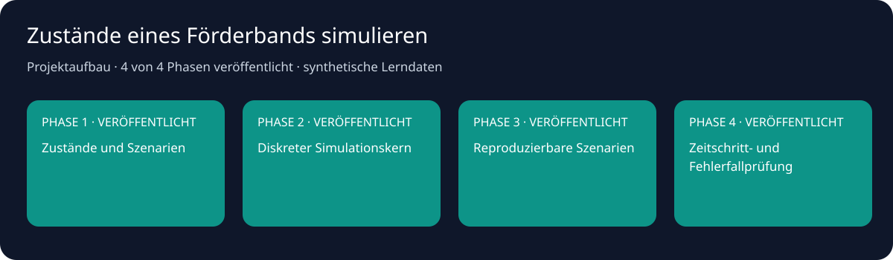

# Zustände eines Förderbands simulieren

Normalbetrieb, Not-Halt und Sensorfehler eines Förderbands sollen vor Versuchen an echter Hardware nachvollziehbar geprüft werden.



**Veröffentlichungsstand: Phase 4/4.** Dieses eigenständige Repository übernimmt zunächst den bereits lokal committeten Stand. Weitere fachliche Phasen werden im Abstand von mindestens vier Stunden veröffentlicht. Die technische Entwicklung und die öffentliche Veröffentlichung haben unterschiedliche echte Zeitpunkte.

## Was hier zu sehen ist

| Schritt | Inhalt | Hier veröffentlicht |
|---|---|---|
| 1 | Zustände und Szenarien | Ja |
| 2 | Diskreter Simulationskern | Ja |
| 3 | Reproduzierbare Szenarien | Ja |
| 4 | Zeitschritt- und Fehlerfallprüfung | Ja |

## Fachlicher Nutzen

Zustandsmodellierung, reproduzierbare Simulation und technische Fehlerfallanalyse.

## Lokal starten

Im geklonten Repository ausführen; die benötigte Laufzeit muss installiert sein. Python-Beispiele verwenden 3.12, Node-Beispiele 24 und C# die im Projekt angegebene .NET-Version. Befehle mit uv laden die dort genau bezeichneten Pakete bei Bedarf.

```powershell
python -X utf8 nachweise/pruefe_szenarien.py
```

Ausführliche technische Befehle: [START.md](START.md). [Öffentlicher Prüfstand](ABNAHME.json) und [Quellphasen](VERLAUF.json) dokumentieren Herkunft und echte Ausführungsdaten. Eine neue Repositorykopie ist kein neuer nativer Desktoplauf.

## Ergebnis des lokal geprüften Schlussstands

Normalbetrieb, Not-Halt und Sensorfehler mit festem Zeitschritt tatsächlich ausgeführt.

## Demo

Live: <https://jorxas.github.io/maschinenzustand-simulation/> (Deutsch, mit Umschalter auf Französisch).

Die Demo zeigt einen Anwendungsfall: Was passiert nach einem Not-Halt oder Sensorfehler? Die Seite hat einen Simulator zum Anklicken (Start, Zeitschritt, Stopp, Not-Halt, Sensorfehler, Rücksetzen) und spielt die drei Szenarien aus `beispieldaten/szenarien.json` ab. Jeder Klick schlägt eine echte Ausgabe von `zeitschritt_ausfuehren()` aus `src/simulation.py` nach: alle 24 Kombinationen aus Zustand und Eingabe wurden vorab mit dem Python-Code berechnet und aufgezeichnet. Die Seite ist statisch, Python läuft nicht im Browser. Es wird keine Maschine gesteuert.

Neu erzeugen und prüfen (Python ab 3.9, Node 24, `puppeteer-core` und ein installierter Chrome):

```powershell
python -X utf8 demo/erzeugen.py   # echte Läufe aufzeichnen -> demo/daten/lauf.js
node tools/seite-bauen.cjs        # statische Seite nach dist/
node tools/browser-pruefen.cjs    # Browserprüfung: Deutsch, Französisch, Handybreite
```

## Grenzen

Keine echte Maschine und kein Simulink-, ISG- oder SCADA-Produktlauf.

Eigenes kleines Lernprojekt mit synthetischen Daten, mit KI-Unterstützung entwickelt und geprüft. Keine Aussage über Berufserfahrung, menschliche Arbeitsstunden oder praktische Verwendung weiterer nur geplanter Produkte.

## Entwicklungshistorie

[Entwicklungshistorie](HISTORIE.md): die vorhandenen lokalen Änderungen, ihre ursprünglichen Daten und die spätere GitHub-Übernahme.
